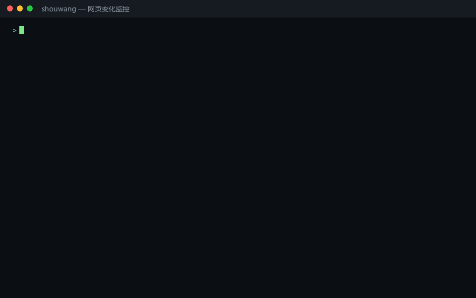
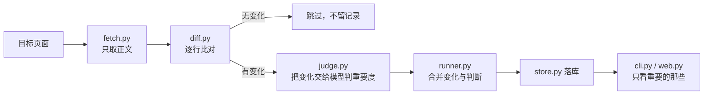

# Shouwang · Page Change Watch

[](https://github.com/wushiyi105-jpg/shouwang/actions) []() [](./LICENSE) [](https://codecov.io/gh/wushiyi105-jpg/shouwang)

Give it a URL and one sentence about what you care about, and it looks in on a schedule. When something changes, it does not tell you first — it asks the model: is this actually worth a notification?



## Why this exists

I once wrote a "notify me when the page changes" script for a product page. On day three I turned it off: a dozen alerts a day, all of them recommendation slots reshuffling, a visit counter ticking up, an ad image being swapped. The one time the price actually dropped, the alert was buried in noise and I never saw it.

So I split the job differently: **diff only reports "the page moved", the model decides "should this wake you up"**. One rule is written into the prompt — when unsure, call it not important; missing a change is better than being annoying. Changes it suppresses are still recorded, so you can always go back and see what it blocked (`events` where `important=0`).

## Features

- **The model can veto.** It is not a raw diff alert. Price, stock, terms, deadlines — those are worth a shout. Layout, ad slots, random content, timestamps — never.
- **Noise is auditable.** Every change is stored, including the ones judged unimportant. The Web UI shows "the model blocked N changes for you".
- **Local files work too.** `file://` or a plain path. If you want to rehearse "what happens if the page changes" offline, you do not have to crawl someone else's site.
- **Keeps the last 50 snapshots.** You can look back at "what changed last Wednesday", not just the latest run.
- **Zero dependencies.** Fetching, text extraction, diffing, storage — all standard library. No Playwright, no bs4.
- **Both CLI and Web.** The CLI suits cron jobs; the Web UI suits clicking "check now" and reading what the model says.

## Quick start

```bash
git clone https://github.com/wushiyi105-jpg/shouwang.git
cd shouwang
cp .env.example .env        # Windows: copy .env.example .env
# open .env and fill in LLM_API_KEY
```

Add a watch, run once to establish the baseline (copy a sample page out first and treat it as the target):

```bash
cp samples/price-v1.html price.html          # Windows: copy samples\price-v1.html price.html
python -m shouwang add "青梧耳机·价格" "price.html" --focus "价格、库存、发货时效"
python -m shouwang run --only "青梧耳机·价格"
```

Now overwrite it with the v2 sample (simulating a price change) and run again:

```bash
cp samples/price-v2.html price.html          # Windows: copy samples\price-v2.html price.html
python -m shouwang run --only "青梧耳机·价格"
```

```
! 青梧耳机·价格  有变化：+4 / -4 行
   模型判断：重要[high] — 降价至399，库存仅3件
   理由：价格从499降到399，库存从12件减到3件，促销截止日提前到11月30日，发货时效从48小时延长到72小时。
   建议：要买就尽快，库存只剩3件；留意发货已变成72小时内。
```

Start the Web UI:

```bash
python -m shouwang serve         # http://127.0.0.1:8766
```

Run in Docker (the container uses the default port 8766):

```bash
docker build -t shouwang .
docker run -p 8766:8766 shouwang
```

## Command reference

| Command | What it does |
| --- | --- |
| `python -m shouwang add <名字> <网址> --focus "关注点"` | Add a watch; `--interval 30` sets the suggested interval in minutes |
| `python -m shouwang list` | List all watches and the last fetch time |
| `python -m shouwang run` | Run once (enabled watches only); `--only <名字>` picks one |
| `python -m shouwang run --loop --every 300` | Stay resident, sweep every 300 seconds |
| `python -m shouwang events --important-only` | Only the ones that actually alerted you |
| `python -m shouwang show <名字>` | Last 10 fetches + 10 events |
| `python -m shouwang enable / disable <名字>` | Turn on / off |
| `python -m shouwang rm <名字>` | Delete (history and events go with it) |
| `python -m shouwang serve --port 8766` | Web UI |

## 🤔 Why not just ask a general LLM

A general model can tell you "this page changed". Shouwang adds the three things it cannot:

1. **Filter before shouting** — a raw diff counts layout, ad slots and timestamps as changes. Here the body text of two snapshots is diffed first, then the model judges: a price, stock, clause or deadline change is worth telling you, everything else is recorded as "not important". The Web UI shows how many the model suppressed, and you can audit those calls.
2. **Reproducible results** — fetching, body extraction and diffing happen locally, the last 50 snapshots are kept so "what changed last Wednesday" is still answerable, and the same two snapshots always diff the same way. The model only judges importance, and you can override it.
3. **Data stays local** — monitors, snapshots and change records live in local SQLite, so watching an internal page or a price sheet does not leak it; a model call sends only the diff excerpt.
4. **Still guards offline** — with no key it keeps fetching and producing diffs, listing changes as they are without ranking them; ranking needs a model.

## 🎯 Use cases

- **Watch one product's price and stock**: add a link with focus "price, stock, shipping time" and get told only when it drops or runs low, instead of refreshing daily.
- **Watch official clauses and deadlines**: tender notices, sign-up cut-offs and terms pages change by a single word; the model separates "deadline moved earlier" from "new banner image".
- **Rehearse on local files**: keep two HTML files locally, monitor by path or `file://`, and see how it would judge a hypothetical change without crawling anyone's site.

## 🗺 Roadmap

- **Daily digest**: merge every monitor's changes in a day into one brief instead of one alert per item.
- **Fetch failure alerts**: after N consecutive failures (403, timeout), say the monitor is broken instead of staying silent.
- **Multi-page comparison per site**: watch a product page and a campaign page together to tell a site-wide change from a single-page edit.
- **Notification outlets**: Webhook or email for the important tier, leaving the rest in the database.
- **Visible ignore rules**: surface rules like "timestamps are not changes" so people can see and edit them.

## ❓ FAQ

**Where do I get an API key?**
The project ships without one. It talks to DeepSeek (`https://api.deepseek.com`) by default — set `LLM_API_KEY`. OpenAI-compatible endpoints and a local Ollama also work.

**Where is data stored, and are snapshots uploaded?**
Monitors, snapshots and change records stay in local SQLite (default `data/shouwang.db`); a model call sends only the diff excerpt of two snapshots, not the whole page.

**Does it work without a key?**
Yes, degraded to raw diffs: it still fetches and still tells you which lines changed, but does not rank importance, so noise rises noticeably.

**How do I switch models?**
Change `LLM_BASE_URL`, `LLM_MODEL` and `LLM_API_KEY`; the fetching logic needs no change.

**Why was a real change not reported?**
It was probably judged unimportant (layout, timestamp, ad slot). The audit list on the Web shows it with the reason; if you disagree, mark it back manually.

## How it works

Five steps, each testable on its own:

1. **Fetch.** `urllib` pulls the page, `HTMLParser` extracts the body, script/style/head are dropped wholesale.
2. **Fingerprint.** Split the body into lines, strip all whitespace, concatenate, sha256. Same fingerprint means stop right there — no model call, no money spent.
3. **Compare.** Set difference over lines, producing "added/changed" and "gone/was". Very short lines ("登录", "首页") are excluded; at most 15 entries are reported per run, so a full-page reflow does not flood you.
4. **Judge.** Focus points plus a change summary go to the model, which must return `{important, level, title, reason, advice}`. If the output is not JSON, it falls back to `important=false` and the event is marked "judgement failed".
5. **Record.** Snapshots go to the database (last 50 per watch), events are stored unconditionally, important ones flagged `important=1`.


### Data flow

How one piece of data moves between the modules:



## Layout

```
shouwang/
├── shouwang/
│   ├── fetch.py     fetch and extract the body (HTMLParser)
│   ├── diff.py      line-by-line comparison, fingerprint
│   ├── judge.py     model judgement (the only step with a veto)
│   ├── runner.py    orchestration of one check
│   ├── store.py     SQLite: watches / snapshots / events
│   ├── llm.py       OpenAI-compatible client (zero dependencies)
│   ├── cli.py       command line
│   └── web.py       http.server page
├── samples/         v1 / v2 product pages (for offline rehearsal)
├── tests/           38 offline unit tests
└── assets/demo.gif
```

## Tests

```bash
python -m unittest discover -s tests -v
```

38 cases, all offline: fetching uses local temp files, model calls are mocked. Covers body extraction (including script/style removal), line comparison and whitespace normalisation, judgement parsing and fallback, the whole SQLite layer, snapshot trimming, and the four Web endpoints.

CI runs 3.10–3.13.

## Things I got wrong

**A `meta` tag swallowed the entire body.** When extracting text I put `meta` and `link` into the "tags to skip" set and tracked skip depth with a counter. The problem: `meta` is self-closing, there is no `</meta>`, so the counter only went up. From that point on the whole page counted as "inside a skipped region" and I got an empty string back. Tests missed it because my fixture HTML had no `meta`; it only showed up on a real product page. The fix: take self-closing tags out of the skip set.

**One extra space counted as a change.** The first version compared raw lines, so when the page went from 2-space to 4-space indentation, diff reported a screenful of "changes" and the model had to judge that nonsense too. Later I split "the line used for comparison" from "the line shown to you": comparison strips all whitespace, display keeps it.

**Hacker News was unreachable.** I wanted to test on its front page, but the TLS handshake from this machine to `news.ycombinator.com` gets cut (same as DuckDuckGo). So the test moved to a public page that does connect, and I shipped a local v1/v2 pair so the "price changed → judgement" chain can be reproduced offline, without depending on someone else's site cooperating.

## Author

shiyi · wushiyi105@gmail.com · [@wushiyi105-jpg](https://github.com/wushiyi105-jpg)

## License

MIT
