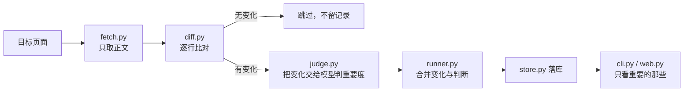

# 守望 · Shouwang

[](https://github.com/wushiyi105-jpg/shouwang/actions) []() [](./LICENSE) [](https://codecov.io/gh/wushiyi105-jpg/shouwang)

[](https://github.com/wushiyi105-jpg/shouwang/actions/workflows/test.yml)

给它一个网址和一句"你盯着什么"，它定时去看一眼。变了，先不告诉你——先问模型：这算不算事。


## 为什么做这个

我早前写过一个"页面变了就发通知"的脚本，盯着一个商品页。第三天我就把它关了：它一天喊十几条，全是推荐位换顺序、访问量加了个数、广告图换了一张。真正降价那次，通知混在一堆噪音里，我根本没看见。

所以这次换了个分工：**diff 只负责发现"页面动了"，模型负责判断"要不要吵你"**。模型的提示词里写死了一条——拿不准就判不重要，宁可漏报也别烦人。被它挡掉的变化也会记进库里，你随时能回头查它挡了什么（`events` 里 `important=0` 的那些）。

## 特性

- **模型有权否决**：不是裸 diff 就提醒。价格、库存、条款、截止日变了才值得喊；排版、广告位、随机内容、时间戳一律不喊。
- **噪音可审计**：每次变化都入库，包括被判为"不重要"的。Web 上直接显示"模型替你挡掉了 N 次"。
- **本地文件也能盯**：`file://` 或直接给路径都行。想先离线演练一遍"如果页面改了会怎样"，不用去爬别人家网站。
- **快照留最近 50 次**：能翻"上周三那次改了什么"，不是只有最后一次。
- **零依赖**：抓取、抽正文、diff、存储全用标准库。没有 Playwright，没有 bs4。
- **CLI 和 Web 都在**：CLI 适合挂定时任务，Web 适合点一下"立刻检查"看模型怎么说。

## 快速开始

```bash
git clone https://github.com/wushiyi105-jpg/shouwang.git
cd shouwang
cp .env.example .env        # Windows: copy .env.example .env
# 打开 .env 填 LLM_API_KEY
```

加一个监控，跑第一次建立基线（先用示例页复制一份出来当"目标页面"）：

```bash
cp samples/price-v1.html price.html          # Windows: copy samples\price-v1.html price.html
python -m shouwang add "青梧耳机·价格" "price.html" --focus "价格、库存、发货时效"
python -m shouwang run --only "青梧耳机·价格"
```

现在把示例的 v2 覆盖上去（模拟商家改价），再跑一次：

```bash
cp samples/price-v2.html price.html          # Windows: copy samples\price-v2.html price.html
python -m shouwang run --only "青梧耳机·价格"
```

```
! 青梧耳机·价格  有变化：+4 / -4 行
   模型判断：重要[high] — 降价至399，库存仅3件
   理由：价格从499降到399，库存从12件减到3件，促销截止日提前到11月30日，发货时效从48小时延长到72小时。
   建议：要买就尽快，库存只剩3件；留意发货已变成72小时内。
```

起 Web：

```bash
python -m shouwang serve         # http://127.0.0.1:8766
```

## 命令参考

| 命令 | 作用 |
| --- | --- |
| `python -m shouwang add <名字> <网址> --focus "关注点"` | 加监控，`--interval 30` 设建议间隔（分钟） |
| `python -m shouwang list` | 看所有监控和上次抓取时间 |
| `python -m shouwang run` | 跑一次（默认只跑启用的），`--only <名字>` 指定一个 |
| `python -m shouwang run --loop --every 300` | 常驻循环，每 300 秒扫一遍 |
| `python -m shouwang events --important-only` | 只看真的提醒过你的 |
| `python -m shouwang show <名字>` | 最近 10 次抓取 + 10 条事件 |
| `python -m shouwang enable / disable <名字>` | 开关 |
| `python -m shouwang rm <名字>` | 删除（历史和事件一起删） |
| `python -m shouwang serve --port 8766` | Web 界面 |

## 工作原理

五步，每步都能单独测：

1. **抓**：`urllib` 拉页面，`HTMLParser` 抽正文，script/style/head 整段扔掉。
2. **指纹**：把正文按行切开、去掉所有空白，拼起来算 sha256。指纹一样就直接结束——不调模型，不花钱。
3. **比**：按行做集合差，得到"新增/变成"和"消失/原本是"。太短的行（"登录""首页"）不参与比较；一次最多报 15 条，防止整页重排时刷屏。
4. **判**：把关注点 + 变化摘要给模型，要求输出 `{important, level, title, reason, advice}`。模型输出不是 JSON 就给保守默认值 `important=false`，并在事件里标"判断失败"。
5. **记**：快照存库（每个监控留最近 50 次），事件无条件入库，重要的标 `important=1`。

### 数据流

一条数据在这几个模块之间怎么走：



## 目录结构

```
shouwang/
├── shouwang/
│   ├── fetch.py     抓取、抽正文（HTMLParser）
│   ├── diff.py      按行比对、指纹
│   ├── judge.py     模型判断（唯一有否决权的一步）
│   ├── runner.py    一次检查的编排
│   ├── store.py     SQLite：watches / snapshots / events
│   ├── llm.py       OpenAI 兼容客户端（零依赖）
│   ├── cli.py       命令行
│   └── web.py       http.server 页面
├── samples/         v1 / v2 两版商品页（离线演练用）
├── tests/           38 个离线单测
└── assets/demo.gif
```

## 测试

```bash
python -m unittest discover -s tests -v
```

38 个用例，全部离线：抓取用本地临时文件，模型调用被 mock。覆盖了正文抽取（含 script/style 剔除）、行比对与空白归一、判断结果解析与降级、SQLite 全套、快照裁剪、以及 Web 的四个接口。

CI 跑 3.10–3.13。

## 踩过的坑

**`meta` 标签把整页正文吞掉了。** 抽正文时我把 `meta`、`link` 放进了"要跳过的标签"集合，然后用一个计数器记跳过深度。问题是 `meta` 是自闭合标签，没有 `</meta>`，计数器只加不减，从那以后整页内容全被当成"跳过区"，抓回来是空字符串。测试没抓到，因为我造的测试 HTML 里没有 `meta`；是拿真实的商品页跑才暴露的。修法是把自闭合标签移出跳过集合。

**多一个空格就算内容变了。** 第一版直接比原行，页面缩进从 2 空格变 4 空格，diff 报了一屏"变化"，模型还得为这种破事判断一次。后来把"比较用的行"和"展示用的行"分开：比较时去掉所有空白，展示时保留原样。

**Hacker News 抓不到。** 我本来想拿它首页实测，本机到 `news.ycombinator.com` 的 TLS 握手直接被断（和 DuckDuckGo 一个毛病）。所以实测对象换成了一个能通的公开页，另外给了一份本地 v1/v2 页面，让"改价→判断"这条链路能离线复现，不用靠别人家的网站配合。

## 作者

shiyi · wushiyi105@gmail.com · [@wushiyi105-jpg](https://github.com/wushiyi105-jpg)

## License

MIT
